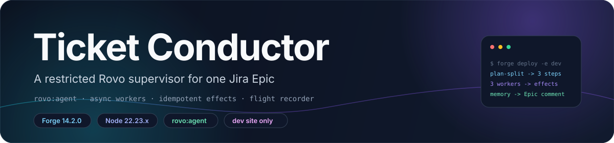
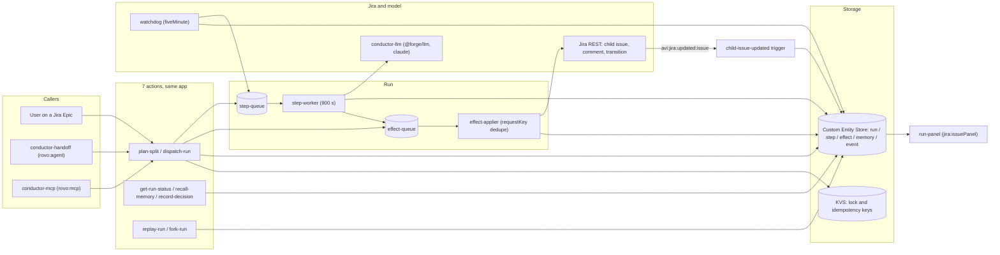

<div align="center">



# Ticket Conductor

**A restricted Rovo supervisor that turns one Jira Epic into a supervised, parallel run.**

Jira as the ledger · one confirm before anything is created · idempotent Jira effects · watchdog retries · replay and fork

[**简体中文**](README.zh-CN.md) · **English**

<a href="LICENSE"></a>
<a href=".github/workflows/ci.yml"></a>
<a href="manifest.yml"></a>
<a href="manifest.yml"></a>
<a href="docs/reference.md"></a>

</div>

> [!NOTE]
> **Current state.** Development-stage entry for Codegeist 2026. The two agents, seven actions, two
> queue consumers, the watchdog, the Flight Recorder, and the simulation harness are in this
> repository, and nothing here is deployed to production. Live end-to-end runs are development-site
> work only, scheduled in [`docs/milestones.md`](docs/milestones.md).

## ✨ Features

- **Restricted Router.** `conductor-router` is a `rovo:agent` whose whole tool list is seven actions; it never writes to Jira itself.
- **Confirm before creation.** `plan-split` stores a run as `planning` and does not return a confirmation token. The Run panel mints a single-use HMAC and starts the run. `dispatch-run` without that token enqueues nothing.
- **One child issue per step.** Each plan step becomes a Jira child issue plus a `step` record in the Custom Entity Store.
- **Workers are consumers, not agents.** `step-worker` runs on `step-queue` with `timeoutSeconds: 900`; `workerType` picks a handler inside that consumer.
- **Idempotent Jira writes.** Every create, comment, and transition is an `effect` keyed by `sha256(runId|stepId|kind|discriminator)`; the attempt number is not in the key.
- **Watchdog.** A `scheduledTrigger` every five minutes requeues a step that missed its deadline or sat queued more than ten minutes, up to three attempts.
- **Flight recorder.** An append-only `event` entity per run backs dry-run replay against today's Jira and fork-from-step-N.
- **Memory that reaches the next plan.** A finished run writes one `[Conductor memory]` comment; recalled memories are injected inside a 1,536-byte budget.
- **Blast-radius preview.** `previewBlastRadius` lists the Jira writes a plan will make, before anything is dispatched.
- **Simulation-tested.** `npm test` runs the suite under `node --test`, including in-memory fakes for KVS, queues, Jira REST, Confluence CQL, and `@forge/llm`, with per-scenario KVS byte budgets. `npm run safety-eval` prints the irreversible-action checks.

## 🧠 Architecture



The implementation is split by package under [`src/`](src): `actions/` holds the seven handlers and
the shared action contract, `run/` the state machine, dependency graph, locks, wave digests, and the
Forge Jira client, `store/` the entities and both adapters, `effects/` the queue and applier,
`worker/` the step worker and its `workerType` handlers, `watchdog/` the retry pass, `memory/` the
write-back and lessons, `recorder/` the flight recorder, `blast/` the preview, `skills/` the pack
loader and briefs, and `frontend/` plus `resolvers/` the UI Kit Run panel.

The design rationale is in [`docs/DESIGN.md`](docs/DESIGN.md); the super-agent mapping is in
[`docs/superagent-architecture.md`](docs/superagent-architecture.md).

## 🛡️ Safety mechanisms and how to test them

Every Jira write goes through a gated, deduplicated path, and the effect of a plan is previewed before it runs.

| Mechanism | Where to read it |
|---|---|
| Blast-radius preview and compensating undo | [`docs/blast-radius.md`](docs/blast-radius.md), `src/blast/preview.js` |
| Confirmation token checked before `dispatch-run` writes | `src/safety/guard.js`, `prompts/router.md` |
| Gated children created only after approval | `stepIdsBlockedByOpenApproval` in `src/run/approval.js` |
| Step, model-call, and wall-clock hard stop | `runBudgetStop` in `src/run/budget.js` |
| Architecture freeze (scope, queues, effects, storage shape) | [`docs/freeze.md`](docs/freeze.md) |
| Human approval gate for risky runs | `src/run/approval.js` |
| Panel HMAC confirmation (single-use, expiring, not in the tool result) | `src/safety/grants.js`, `src/resolvers/index.js` |
| Budget stop drains pending forward effects | `src/run/budget.js` |
| Deduplicated Jira writes via `requestKey` | `src/effects/requestKey.js` |
| End-to-end simulated scenarios | `tests/simulation/scenarios.test.mjs` |

```sh
npm ci && npm test      # full suite, no network, no Jira
npm run test:headroom   # simulation scenarios with per-scenario KVS byte budgets
npm run safety-eval     # irreversible-action table
npm run safety-eval     # pass/fail table of the irreversible-action checks
```

> This is a public snapshot of a Codegeist 2026 project. It is simulation-only: the tests run against in-memory fakes, and nothing here has been run against a live Jira site or a live LLM.

## 🚀 Quick start

**Requirements:** Node 22.23.x (CI pins 22.23.4), Forge CLI 14.2.0, and a Jira Cloud site with Rovo
enabled for anything that runs live. No Forge SQL and no external egress are used.

```sh
git clone https://github.com/LeoLin990405/ticket-conductor-safety.git
cd ticket-conductor-safety
npm ci
export FORGE_EMAIL='<your Atlassian account email>'
export FORGE_API_TOKEN='<token from id.atlassian.com/manage-profile/security/api-tokens>'
npm run lint     # = forge lint
npm test         # = node --test
```

Deploy to the development environment and install on a site:

```sh
forge deploy -e development
forge install -e development --site '<your-site>.atlassian.net' --product jira
forge install --upgrade -e development --site '<your-site>.atlassian.net' --product jira  # after scope changes
forge tunnel                                                                                # local iteration
```

> [!WARNING]
> **Development environment only.** Do not `forge deploy -e production` or install on any other
> site. Several files here are marked "development only" for that reason.

> [!TIP]
> `dev-dispatch` plans or dispatches a run without Rovo chat. It answers 403 unless the request
> carries `x-dev-secret` equal to `DEV_WEBTRIGGER_SECRET`, which is set only in development. Create
> it with `forge webtrigger create -e development -s <site> -p jira -f dev-dispatch`; request bodies
> are in [`docs/reference.md`](docs/reference.md#environment-variables-and-development-flags).

## 🤖 Agent integrations

Two agents are declared in [`manifest.yml`](manifest.yml), and both of them reach Jira only through
the same seven actions.

| Agent | Reaches | Skill | Prompt |
|---|---|---|---|
| `conductor-router` | `plan-split`, `dispatch-run`, `get-run-status`, `recall-memory`, `record-decision`, `replay-run`, `fork-run` | `conductor-playbook` | [prompts/router.md](prompts/router.md) |
| `conductor-handoff` | `plan-split`, `dispatch-run`, `get-run-status`, `recall-memory` | `conductor-tools` | [prompts/handoff.md](prompts/handoff.md) |

| Action | Purpose | Writes Jira? |
|---|---|---|
| `plan-split` | Validate `stepsJson`, store a run as `planning`, return the recalled memories | no |
| `dispatch-run` | Start a stored run; enqueue child-issue effects and ready steps | indirectly, through effects |
| `get-run-status` | Read a run and its steps | no |
| `recall-memory` | Return project memories plus the skill index | no |
| `record-decision` | Store one `decision`, `lesson`, or `fact` | no |
| `replay-run` | Dry-run against today's Jira and diff | no |
| `fork-run` | Copy the log to step N and re-run downstream steps | through effects |

`rovo:mcp` module `conductor-mcp` publishes `plan-split`, `dispatch-run`, `get-run-status`, and
`recall-memory` as MCP tools. It is a Preview module, one per app, and external clients stay
disabled until a site admin enables them. [`demo/mcp-client.mjs`](demo/mcp-client.mjs) prints the
endpoint and the JSON-RPC calls, or runs the same four handlers against the in-memory store;
[`demo/cursor-mcp.json`](demo/cursor-mcp.json) is the matching client config.

## 🗂️ How a run works

| Stage | Behaviour |
|---|---|
| Plan | `plan-split` rejects more than eight steps, an unknown `workerType`, an out-of-range `dependsOn`, and any cycle; a rejected plan stores nothing |
| Dispatch | `dispatch-run` moves the run from `planning` to `running`, enqueues one `createIssue` per step, and pushes the ready steps to `step-queue` |
| Steps | `step-worker` is idempotent per `(stepId, attempt)`; a stale attempt exits without side effects |
| Dependencies | A step stays `waiting` until every `dependsOn` index is `done`; the watchdog does not scan `waiting` |
| Effects | `effect-applier` claims a row, applies it, and stores the result; `applied` and `failed` rows never reach Jira again |
| Watchdog | Attempt < 3 requeues with a new 12-minute deadline; at attempt 3 the step is `failed`, the run `blocked`, and one Epic comment is enqueued |
| Waves | After wave 1 finishes the lead may spawn a later wave, stop, or pause in `awaiting-review`; caps are 3 waves and 8 steps |
| Memory | The `summarize` step produces one `[Conductor memory]` Epic comment and `memory` rows that the next plan recalls |

Effect and step status values, entity attributes, and the compensating kinds are tabulated in
[`docs/reference.md`](docs/reference.md).

## 📁 Repository layout

| Path | Contents |
|---|---|
| `manifest.yml` | All Forge modules: agents, skills, MCP, actions, consumers, triggers, panel, webtrigger, LLM module, entities, scopes |
| `src/actions/` | The seven action handlers, the shared contract, and plan graph validation |
| `src/run/` | Run state machine, dependency graph, locks, wave digests, Forge Jira client |
| `src/store/` | Entity types, store core, Forge adapter, in-memory adapter, generated entity schema |
| `src/effects/` | Effect queue, request keys, applier, Jira payloads, error types |
| `src/worker/` | Step worker, `workerType` handlers, ADF comments, LLM adapter, prompts, guard |
| `src/watchdog/` | Five-minute retry pass, gate, demo hang flag |
| `src/memory/` | Write-back, lessons, scoring, the `[Conductor memory]` comment |
| `src/recorder/` | Event log, journal, replay, fork, re-plan, OTel span fields, timeline |
| `src/skills/`, `skills/` | Skill pack loader, briefs, schema validation, plus the six Markdown packs |
| `src/frontend/`, `src/resolvers/` | UI Kit Run panel and its resolver |
| `src/dev/` | Development-only dispatch webtrigger and a KVS probe |
| `prompts/` | Router and handoff prompts plus the two `rovo:skill` sources |
| `tests/` | `e2e/`, written scenarios, adversarial cases, and the simulation harness with byte budgets |
| `demo/` | Seeded Payments issues, the MCP client demo, and a Cursor config |
| `docs/` | Design, work packages, spikes, milestones, novelty, flight recorder, blast radius, Devpost and video drafts |
| `spikes/` | A separate throwaway Forge app from the week-1 spikes, never merged into the root manifest |

## 🛠️ Development

```sh
npm ci
npm test                    # = node --test
npm run test:simulation     # node --test --test-reporter=spec tests/simulation/*.test.mjs
npm run lint                # forge lint; needs FORGE_EMAIL and FORGE_API_TOKEN
```

- **Simulation harness.** [`tests/simulation/`](tests/simulation) fakes KVS (with read and write byte counters), both queues, Jira REST, Confluence CQL, `@forge/llm`, and the watchdog clock, then drives the real handlers.
- **Byte budgets.** A scenario fails on zero KVS usage or on a cap breach; caps are the measured total plus about 15% in [`tests/simulation/budget.mjs`](tests/simulation/budget.mjs).
- **CI.** [`.github/workflows/ci.yml`](.github/workflows/ci.yml) runs on push and pull request with Node 22.23.4: unit and module tests, then the simulation scenarios, then `forge lint`.
- **Lint needs a token.** The CI lint step exits 0 with a message when `FORGE_API_TOKEN` is not configured, so a green run does not always mean the manifest was linted.
- **Recorded result.** [`docs/milestones.md`](docs/milestones.md) records `npm test` at **295 pass, 1 skipped, 0 fail** on 2026-11-04. That is the repository's own log, not a CI badge.
- **Model off by default.** With `CONDUCTOR_LLM=off` the workers write deterministic comments and store `generator: "fallback"`; `npm test` mocks `chat` and `list` and never calls the SDK.

## 🧭 Scope, limits & roadmap

This is a hackathon project, not a product. The boundaries below are the ones the design and the
tests actually enforce.

| Area | Boundary |
|---|---|
| Hosting | Forge app for Jira Cloud; there is no shell and no code sandbox, so the effects queue plus dry-run is the only staging surface |
| Runtime budget | 25 s for a function or resolver, 55 s for an action or webtrigger, 900 s for an async consumer |
| Storage | Custom Entity Store plus KVS; one KVS value is capped at 240 KiB, so one event row is one fact |
| Model | `@forge/llm` with family `claude` only, inference capped at 5 minutes; calls are billed to the app developer and there is no free quota |
| External egress | None declared; URL fetches are outside the agent's tool list |
| Agents | Forge has no agent-to-agent call, so workers are queue consumers and are not presented as agents |
| `rovo:mcp` | Preview, one module per app; external clients are disabled until a site admin enables them |
| Live evidence | Several scenarios in [`tests/scenarios/`](tests/scenarios) say "not yet run live"; the repo does not claim otherwise |
| Distribution | No Marketplace publish, no production deploy, no install link |

Roadmap, taken from [`docs/milestones.md`](docs/milestones.md) and [`docs/novelty.md`](docs/novelty.md):

- [ ] Run the five adversarial tries in [`tests/scenarios/06-adversarial-tries.md`](tests/scenarios/06-adversarial-tries.md) against a live Router
- [ ] Enable `rovo:mcp` for one external client and confirm `tools/list`
- [ ] Finish the live end-to-end pass on the demo site (M4)
- [ ] Add the `approval` DAG node and risk-triggered gates (novelty #5)
- [x] Record prior scalar values on `setFields` and restore them with `restoreFields` (a transition already stores `before.statusName`)
- [ ] Record the demo video and finish the Devpost copy (M5, M6)

## 🤝 Contributing

Work package interfaces are documented in [`docs/TASKS.md`](docs/TASKS.md).

1. Interface changes should update `docs/TASKS.md` in the same PR.
2. Before opening a PR, run `npm ci && npm test && npm run lint` and paste the output.
3. Never commit tokens, `.env`, API keys, site credentials, or `forge variables` values.

If the project is useful to you, a ⭐ helps others find it.

## 📄 License & attribution

Released under the MIT License. See [`LICENSE`](LICENSE). `package.json` keeps `"private": true` as an npm publish guard.

Design ideas were drawn from published work — LangGraph, Temporal, DBOS, Inngest, Magentic-One,
OpenTelemetry GenAI semantic conventions, mem0, Graphiti, ExpeL, and others — and are credited per
pattern in [`docs/flight-recorder.md`](docs/flight-recorder.md) and
[`docs/oss-borrow.md`](docs/oss-borrow.md). Both notes state the rule the repository follows: reuse
ideas, not runtimes. `docs/oss-borrow.md` also marks which upstream licenses are safe to borrow from
and which are ideas only.
