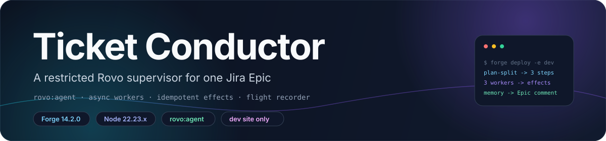
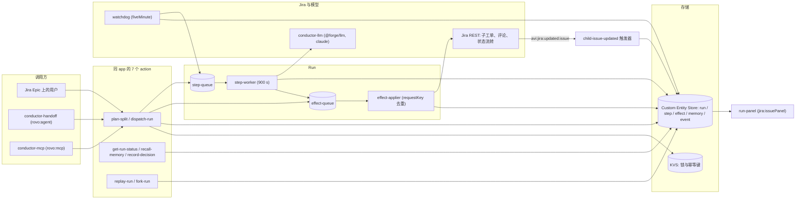

<div align="center">



# Ticket Conductor

**一个受限的 Rovo 监工，把一张 Jira Epic 变成一次可监督的并行执行。**

Jira 即账本 · 确认后才创建 · Jira 副作用幂等 · Watchdog 自动重试 · 可回放、可 fork

**简体中文** · [**English**](README.md)

<a href="LICENSE"></a>
<a href=".github/workflows/ci.yml"></a>
<a href="manifest.yml"></a>
<a href="manifest.yml"></a>
<a href="docs/reference.md"></a>

</div>

> [!NOTE]
> **当前状态。** Codegeist 2026 的开发阶段作品。两个 agent、七个 action、两个队列 consumer、Watchdog、
> Flight Recorder 与模拟测试框架都在本仓库里，没有任何东西部署到 production。live 端到端验证只发生在
> development 站点，排期见 [`docs/milestones.md`](docs/milestones.md)。

## ✨ 特性

- **受限的 Router。** `conductor-router` 是一个 `rovo:agent`，它的全部工具清单就是七个 action；它自己从不写 Jira。
- **先确认，再创建。** `plan-split` 只把 run 存为 `planning`；`dispatch-run` 是另一次调用，所以用户同意之前不会出现任何子工单。
- **每个 step 一张子工单。** 计划里的每个 step 对应一张 Jira 子工单，加一条 Custom Entity Store 里的 `step` 记录。
- **Worker 是队列 consumer，不是 agent。** `step-worker` 跑在 `step-queue` 上，`timeoutSeconds: 900`；`workerType` 只在该 consumer 内部选择处理函数。
- **Jira 写入幂等。** 每次创建、评论、状态流转都是一个 `effect`，键为 `sha256(runId|stepId|kind|discriminator)`；attempt 号不参与计算。
- **Watchdog。** `scheduledTrigger` 每五分钟跑一次，把超过 deadline 或排队超过十分钟的 step 重新入队，最多三次 attempt。
- **Flight Recorder。** 每次 run 都有一条 append-only 的 `event` 记录，支撑对今天 Jira 的 dry-run 回放，以及从某个 step fork。
- **记忆会影响下一次计划。** run 结束后写一条 `[Conductor memory]` 评论；召回的记忆注入时受 1,536 字节预算约束。
- **Blast radius 预览。** `previewBlastRadius` 在 dispatch 之前就列出这次计划会产生哪些 Jira 写入。
- **有模拟测试。** 48 个 `node --test` 测试文件，包括 KVS、队列、Jira REST、Confluence CQL 与 `@forge/llm` 的内存 fake，以及逐场景的 KVS 字节预算。

## 🧠 架构



实现按包拆在 [`src/`](src) 下：`actions/` 是七个 handler 与共享的 action 契约，`run/` 是状态机、
依赖图、锁、wave digest 与 Forge Jira client，`store/` 是实体与两个 adapter，`effects/` 是队列与
applier，`worker/` 是 step worker 与各 `workerType` 处理函数，`watchdog/` 是重试扫描，`memory/` 是
写回与 lesson，`recorder/` 是 flight recorder，`blast/` 是预览，`skills/` 是 skill 包加载与 brief，
`frontend/` 与 `resolvers/` 是 UI Kit 的 Run 面板。

设计理由见 [`docs/DESIGN.md`](docs/DESIGN.md)；与 super-agent 设计的对照见
[`docs/superagent-architecture.md`](docs/superagent-architecture.md)。

## 🛡️ 安全

不可逆动作是应用无法干净撤回的 Jira 写入：创建工单、流转状态、修改标量字段。清单里没有删除工单的 scope。撤销会把子工单转到 Done 并打上 `conductor-rolled-back` 标签；状态只在工单仍停在本次运行留下的状态时才写回；字段只在仍等于本次写入的值时才写回。

模型只有七个 action，自己不能写 Jira。`plan-split` 把 run 存为 `planning`，并且不返回 token。Run 面板签发一次性 HMAC，把已用授权写到 `run.grants`，并在同一次调用里消费它。`startRun` 在每条路径上检查授权。含糊的目标、缺少 Epic 或步骤、畸形参数、伪造、过期或重放的授权，以及存储写入失败，都会在调用 Jira 之前停下。超时或写到一半的 effect 会失败关闭，后续投递不会再次调用 Jira。预算耗尽会排空队列里尚未发出的正向 effect。

在本工作区的 Node v22.23.4 上：

| 命令 | 结果 |
|---|---|
| `npm test` | 366 通过，1 跳过，0 失败 |
| `npm run safety-eval` | 37 通过，0 失败 |
| `npm run demo:offline` | 基线 6 次不可逆 mock Jira 写入，开启防护后 0 次（6 次里 6 次被拦住） |
| `npm audit` | 0 个漏洞 |

这 37 行里有 18 行失败状态矩阵。[`docs/failure-matrix.md`](docs/failure-matrix.md) 把每一类映射到场景 id。[`docs/evidence/safety-eval.json`](docs/evidence/safety-eval.json) 是同一条命令写出的机器可读结果。基线是一个对着原始 mock Jira 的脚本化 agent，不是在线模型。[`docs/threat-model.md`](docs/threat-model.md) 写了资产、参与者、模型 / 面板 / 服务器边界，以及与 Google SAIF 的简短对照。

mock 是本仓库的 REST 模型。超时会使 effect 行失败，但不会取消已经发出的 HTTP 调用。面板上的账号 id 来自 Forge resolver 上下文，没有第二因素。完整限制见 [`docs/drawerrr-submission.md`](docs/drawerrr-submission.md)。

> 这是 Codegeist 2026 项目的公开快照。上表数字来自内存 store 和内存 Jira 客户端。本仓库没有对真实 Jira 站点或真实模型跑过这些检查。

## 🚀 快速开始

**离线，不需要 Forge 账号。** Node 固定为 22.23.4（`.nvmrc`、CI 和 `package.json` 的 `engines`）。

```sh
git clone https://github.com/LeoLin990405/ticket-conductor-safety.git
cd ticket-conductor-safety
npm ci && npm run safety-eval && npm run demo:offline
npm test
npm audit
```

`docker build -t ticket-conductor-safety .` 然后 `docker run --rm ticket-conductor-safety` 会跑同样的 safety eval 和离线 demo。`.devcontainer/devcontainer.json` 使用这个 Dockerfile。

要在 development 站点上真的跑起来，还需要 Forge CLI 14.2.0 和一个启用了 Rovo 的 Jira Cloud 站点。不使用 Forge SQL，也不声明任何外部 egress。

```sh
export FORGE_EMAIL='<你的 Atlassian 账号邮箱>'
export FORGE_API_TOKEN='<来自 id.atlassian.com/manage-profile/security/api-tokens 的 token>'
npm run lint     # = forge lint
```

部署到 development 环境并安装到站点：

```sh
forge deploy -e development
forge install -e development --site '<your-site>.atlassian.net' --product jira
forge install --upgrade -e development --site '<your-site>.atlassian.net' --product jira  # 改过 scope 之后
forge tunnel                                                                                # 本地迭代
```

> [!WARNING]
> **只用于 development 环境。** 不要执行 `forge deploy -e production`，也不要安装到其他站点。
> 仓库里多个文件因此标注为 "development only"。

> [!TIP]
> `dev-dispatch` 可以不经 Rovo 对话直接 plan 或 dispatch 一次 run。除非请求头里 `x-dev-secret`
> 等于 `DEV_WEBTRIGGER_SECRET`，否则它返回 403，而这个变量只在 development 环境设置。用
> `forge webtrigger create -e development -s <site> -p jira -f dev-dispatch` 创建；请求体见
> [`docs/reference.md`](docs/reference.md#environment-variables-and-development-flags)。

## 🤖 Agent 集成

[`manifest.yml`](manifest.yml) 声明了两个 agent，它们都只能通过同一组七个 action 触达 Jira。

| Agent | 可调用的 action | Skill | Prompt |
|---|---|---|---|
| `conductor-router` | `plan-split`、`dispatch-run`、`get-run-status`、`recall-memory`、`record-decision`、`replay-run`、`fork-run` | `conductor-playbook` | [prompts/router.md](prompts/router.md) |
| `conductor-handoff` | `plan-split`、`dispatch-run`、`get-run-status`、`recall-memory` | `conductor-tools` | [prompts/handoff.md](prompts/handoff.md) |

| Action | 作用 | 是否写 Jira |
|---|---|---|
| `plan-split` | 校验 `stepsJson`，把 run 存为 `planning`，返回召回的记忆 | 否 |
| `dispatch-run` | 启动已保存的 run，入队子工单 effect 与就绪 step | 间接，通过 effects |
| `get-run-status` | 读取一次 run 及其 step | 否 |
| `recall-memory` | 返回项目记忆与 skill index | 否 |
| `record-decision` | 存一条 `decision`、`lesson` 或 `fact` | 否 |
| `replay-run` | 对今天的 Jira 做 dry-run 并给出 diff | 否 |
| `fork-run` | 把日志拷贝到第 N 步，只重跑下游 step | 经 effects |

`rovo:mcp` 模块 `conductor-mcp` 把 `plan-split`、`dispatch-run`、`get-run-status`、`recall-memory`
发布为 MCP 工具。它是 Preview 模块，每个 app 只能有一个，外部客户端默认关闭，需要站点管理员开启。
[`demo/mcp-client.mjs`](demo/mcp-client.mjs) 可以打印 endpoint 与 JSON-RPC 调用，也可以用内存 store
跑同样四个 handler；[`demo/cursor-mcp.json`](demo/cursor-mcp.json) 是对应的客户端配置。

## 🗂️ 一次运行的流程

| 阶段 | 行为 |
|---|---|
| Plan | `plan-split` 拒绝超过八个 step、未知 `workerType`、越界的 `dependsOn` 以及任何环；被拒的计划什么都不存 |
| Dispatch | `dispatch-run` 把 run 从 `planning` 推到 `running`，为每个 step 入队一条 `createIssue`，并把就绪的 step 推进 `step-queue` |
| Steps | `step-worker` 按 `(stepId, attempt)` 幂等；过期 attempt 直接退出，不产生副作用 |
| Dependencies | step 在 `dependsOn` 里每个 index 都 `done` 之前保持 `waiting`；Watchdog 不扫描 `waiting` |
| Effects | `effect-applier` 先认领行，再应用，再存结果；`applied` 与 `failed` 的行不会再发往 Jira |
| Watchdog | attempt < 3 时以新的 12 分钟 deadline 重新入队；到 attempt 3 时 step 变 `failed`、run 变 `blocked`，并入队一条 Epic 评论 |
| Waves | 第 1 个 wave 结束后，lead 可以再开一个 wave、停止，或停在 `awaiting-review`；上限是 3 个 wave、8 个 step |
| Memory | `summarize` step 产出一条 `[Conductor memory]` Epic 评论和若干 `memory` 行，供下一次计划召回 |

effect 与 step 的状态取值、实体属性、补偿类 kind 都在
[`docs/reference.md`](docs/reference.md) 里有列表说明（英文）。

## 📁 仓库结构

| 路径 | 内容 |
|---|---|
| `manifest.yml` | 全部 Forge 模块：agent、skill、MCP、action、consumer、触发器、面板、webtrigger、LLM 模块、实体、scope |
| `src/actions/` | 七个 action handler、共享契约与计划图校验 |
| `src/run/` | run 状态机、依赖图、锁、wave digest、Forge Jira client |
| `src/store/` | 实体类型、store core、Forge adapter、内存 adapter、生成的实体 schema |
| `src/effects/` | effect 队列、request key、applier、Jira payload、错误类型 |
| `src/worker/` | step worker、`workerType` 处理函数、ADF 评论、LLM adapter、prompt、guard |
| `src/watchdog/` | 五分钟重试扫描、gate、演示用挂起开关 |
| `src/memory/` | 写回、lesson、评分、`[Conductor memory]` 评论 |
| `src/recorder/` | 事件日志、journal、replay、fork、re-plan、OTel span 字段、时间线 |
| `src/skills/`、`skills/` | skill 包加载、brief、schema 校验，以及六个 Markdown skill 包 |
| `src/frontend/`、`src/resolvers/` | UI Kit 的 Run 面板及其 resolver |
| `src/dev/` | development 专用的 dispatch webtrigger 与一个 KVS probe |
| `prompts/` | Router 与 handoff 的 prompt，以及两个 `rovo:skill` 源目录 |
| `tests/` | `e2e/`、书面场景、对抗用例，以及带字节预算的模拟测试框架 |
| `demo/` | Payments 项目的种子数据、MCP 客户端 demo、Cursor 配置 |
| `docs/` | 设计、工作包、spike、里程碑、novelty、flight recorder、blast radius、Devpost 与视频草稿 |
| `spikes/` | 第 1 周 spike 用的独立一次性 Forge app，从未合入根 manifest |

## 🛠️ 开发

```sh
npm ci
npm test                    # = node --test
npm run test:simulation     # node --test --test-reporter=spec tests/simulation/*.test.mjs
npm run lint                # forge lint；需要 FORGE_EMAIL 与 FORGE_API_TOKEN
```

- **模拟测试框架。** [`tests/simulation/`](tests/simulation) 提供 KVS（带读写字节计数）、两个队列、Jira REST、Confluence CQL、`@forge/llm` 与 Watchdog 时钟的 fake，然后驱动真实 handler。
- **字节预算。** 场景在 KVS 用量为零或超过上限时失败；上限取自实测量加约 15%，写在 [`tests/simulation/budget.mjs`](tests/simulation/budget.mjs)。
- **CI。** [`.github/workflows/ci.yml`](.github/workflows/ci.yml) 在 push 与 PR 时用 Node 22.23.4 跑三步：单元与模块测试、模拟场景、`forge lint`。
- **lint 需要 token。** 未配置 `FORGE_API_TOKEN` 时 CI 的 lint 步骤打印说明并以 0 退出，所以绿色的 CI 并不总等于 manifest 被 lint 过。
- **已记录的结果。** [`docs/milestones.md`](docs/milestones.md) 记录 2026-11-04 的 `npm test` 为 **295 pass、1 skipped、0 fail**。这是仓库自己的日志，不是 CI 徽章。
- **默认不调用模型。** `CONDUCTOR_LLM=off` 时 worker 写确定性评论并在输出里记 `generator: "fallback"`；`npm test` 会 mock `chat` 与 `list`，从不调用 SDK。

## 🧭 范围、限制与路线图

这是一个 hackathon 项目，不是产品。下面这些边界是设计与测试真正约束到的。

| 方面 | 边界 |
|---|---|
| 运行环境 | Jira Cloud 上的 Forge app；没有 shell，也没有代码沙箱，所以 effects 队列加 dry-run 是唯一的暂存层 |
| 运行时限 | function 与 resolver 25 秒，action 与 webtrigger 55 秒，async consumer 900 秒 |
| 存储 | Custom Entity Store 加 KVS；单个 KVS value 上限 240 KiB，所以一条事件只写一条事实 |
| 模型 | 只用 `@forge/llm` 的 `claude` family，推理上限 5 分钟；调用计费到 app 开发者，没有免费额度 |
| 外部 egress | 未声明；URL 抓取不在 agent 的工具清单里 |
| Agent | Forge 没有 agent-to-agent 调用，所以 worker 是队列 consumer，不会被包装成 agent |
| `rovo:mcp` | Preview，每个 app 一个；外部客户端默认关闭，需站点管理员开启 |
| 实测证据 | [`tests/scenarios/`](tests/scenarios) 里多个场景标注 "not yet run live"，仓库不会给出相反的说法 |
| 分发 | 没有 Marketplace 上架、没有 production 部署、没有安装链接 |

路线图来自 [`docs/milestones.md`](docs/milestones.md) 与 [`docs/novelty.md`](docs/novelty.md)：

- [ ] 用真实 Router 跑完 [`tests/scenarios/06-adversarial-tries.md`](tests/scenarios/06-adversarial-tries.md) 里的五个对抗用例
- [ ] 让一个外部客户端连上 `rovo:mcp` 并确认 `tools/list`
- [ ] 在 demo 站点完成 live 端到端验证（M4）
- [ ] 增加 `approval` DAG 节点与按风险触发的 gate（novelty #5）
- [ ] 为 transition 与字段编辑保存 `before` 快照，然后启用 `restoreFields`
- [ ] 录制演示视频并完成 Devpost 文案（M5、M6）

## 🤝 参与贡献

工作包接口见 [`docs/TASKS.md`](docs/TASKS.md)。

1. 接口变更应在同一个 PR 里更新 `docs/TASKS.md`。
2. 开 PR 之前运行 `npm ci && npm test && npm run lint` 并把输出贴进 PR。
3. 绝不提交 token、`.env`、API key、站点凭据或 `forge variables` 的值。

如果这个项目对你有用，欢迎点个 ⭐。

## 📄 许可证与署名

本仓库采用 MIT 许可证，见 [`LICENSE`](LICENSE)。`package.json` 保留 `"private": true` 作为 npm 发布保护。

设计思路借鉴了公开发表的工作——LangGraph、Temporal、DBOS、Inngest、Magentic-One、OpenTelemetry
GenAI semantic conventions、mem0、Graphiti、ExpeL 等——按 pattern 逐条署名在
[`docs/flight-recorder.md`](docs/flight-recorder.md) 与 [`docs/oss-borrow.md`](docs/oss-borrow.md)。
这两份说明都写明了本仓库遵循的规则：借用思路，不搬运行时。`docs/oss-borrow.md` 也标出了哪些上游
许可证可以借用、哪些只能借思路。

详细文档（docs/*）当前以英文为主。
