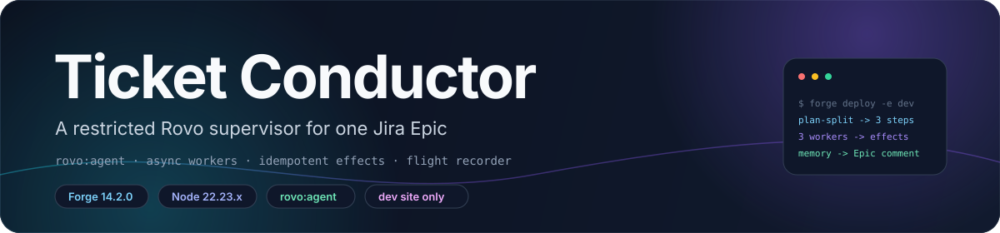
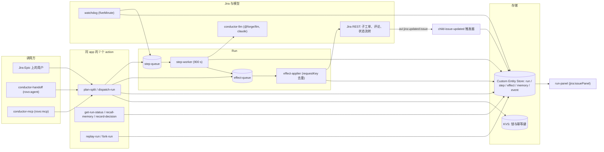

<div align="center">



# Ticket Conductor

**一个受限的 Rovo 监工，把一张 Jira Epic 变成一次可监督的并行执行。**

Jira 即账本 · 确认后才创建 · Jira 副作用幂等 · Watchdog 自动重试 · 可回放、可 fork

**简体中文** · [**English**](README.md)

<a href="LICENSE"></a>
<a href=".github/workflows/ci.yml"></a>
<a href="manifest.yml"></a>
<a href="manifest.yml"></a>
<a href="docs/reference.md"></a>

</div>

> [!NOTE]
> **当前状态。** Codegeist 2026 的开发阶段作品。两个 agent、七个 action、两个队列 consumer、Watchdog、
> Flight Recorder 与模拟测试框架都在本仓库里，没有任何东西部署到 production。live 端到端验证只发生在
> development 站点，排期见 [`docs/milestones.md`](docs/milestones.md)。

## 🎯 项目概述与解决的问题

Ticket Conductor 是面向 Jira 工作协调者的开发阶段 Atlassian Forge app。它把一张 Epic
拆成最多八个步骤，监督队列 worker、依赖、重试和结果汇报。要解决的不只是任务拆解：
拥有原始写入工具的 AI 可能重复创建工单、服从工单里的恶意指令，或在未获批准、预算耗尽时继续写入。

本安全参赛版本把**规划与执行分开**：模型通过受限 action 提出计划，用户先在 Run 面板查看影响范围，
服务器拿到人工授权后才启动 Jira effects。目标是范围受控、可检查的流程，而不是拥有无限 Jira 权限的自主 agent。
下文证据全部来自离线测试，不代表生产安全认证。

**评审导航：** [项目概述](#-项目概述与解决的问题) · [安全机制](#-安全) ·
[支持证据与示例](#-支持证据) · [局限与改进](#-范围限制与路线图)。

## ✨ 特性

- **受限的 Router。** `conductor-router` 是一个 `rovo:agent`，它的全部工具清单就是七个 action；它自己从不写 Jira。
- **先确认，再创建。** `plan-split` 只把 run 存为 `planning`，不返回确认 token；Run 面板签发并消费一次性 HMAC 授权，缺少授权的 `dispatch-run` 不会入队。
- **每个 step 一张子工单。** 计划里的每个 step 对应一张 Jira 子工单，加一条 Custom Entity Store 里的 `step` 记录。
- **Worker 是队列 consumer，不是 agent。** `step-worker` 跑在 `step-queue` 上，`timeoutSeconds: 900`；`workerType` 只在该 consumer 内部选择处理函数。
- **Jira 写入幂等。** 每次创建、评论、状态流转都是一个 `effect`，键为 `sha256(runId|stepId|kind|discriminator)`；attempt 号不参与计算。
- **Watchdog。** `scheduledTrigger` 每五分钟跑一次，把超过 deadline 或排队超过十分钟的 step 重新入队，最多三次 attempt。
- **Flight Recorder。** 每次 run 都有一条 append-only 的 `event` 记录，支撑对今天 Jira 的 dry-run 回放，以及从某个 step fork。
- **记忆会影响下一次计划。** run 结束后写一条 `[Conductor memory]` 评论；召回的记忆注入时受 1,536 字节预算约束。
- **Blast radius 预览。** `previewBlastRadius` 在 dispatch 之前就列出这次计划会产生哪些 Jira 写入。
- **有模拟测试。** `npm test` 使用 `node --test`，包括 KVS、队列、Jira REST、Confluence CQL 与 `@forge/llm` 的内存 fake，以及逐场景的 KVS 字节预算；`npm run safety-eval` 检查不可逆动作防护。

## 🧠 架构



实现按包拆在 [`src/`](src) 下：`actions/` 是七个 handler 与共享的 action 契约，`run/` 是状态机、
依赖图、锁、wave digest 与 Forge Jira client，`store/` 是实体与两个 adapter，`effects/` 是队列与
applier，`worker/` 是 step worker 与各 `workerType` 处理函数，`watchdog/` 是重试扫描，`memory/` 是
写回与 lesson，`recorder/` 是 flight recorder，`blast/` 是预览，`skills/` 是 skill 包加载与 brief，
`frontend/` 与 `resolvers/` 是 UI Kit 的 Run 面板。

设计理由见 [`docs/DESIGN.md`](docs/DESIGN.md)；与 super-agent 设计的对照见
[`docs/superagent-architecture.md`](docs/superagent-architecture.md)。

## 🛡️ 安全

这里的不可逆动作是无法干净抹除的 Jira 写入：创建工单、流转状态、修改标量字段。评论也是写入，
但应用可以删除自己写的评论，因此不计入离线演示的不可逆写入次数。撤销后新建工单仍然存在；
manifest 没有删除工单的 scope。

| 边界 | 已实现的防护 | 代码 / 证据 |
|---|---|---|
| 模型 → 工具 | Router 只有七个 action，没有原始 Jira 写工具。`plan-split` 校验目标与计划，只存 `planning`，不返回确认 token。 | [`manifest.yml`](manifest.yml)、[`src/actions/index.js`](src/actions/index.js)、[`src/safety/goal.js`](src/safety/goal.js) |
| 人工 → 执行 | Run 面板读取 Forge resolver 上下文账号，不信任 payload 账号。签发与 run 影响范围卡片绑定、15 分钟有效、一次性使用的 HMAC 授权，并在同次调用消费。面板路径把授权元数据共享到 `run.grants`，公开响应不包含 token 或授权行。 | [`src/resolvers/index.js`](src/resolvers/index.js)、[`src/safety/grants.js`](src/safety/grants.js) |
| 规划 → 队列 | `startRun` 在启动前检查授权；单独 `confirm: true`、伪造、过期、跨 run 或重放的授权不入队。共享授权存储失败则拒绝启动。被未开放 approval gate 拦住的步骤，连子工单创建也会推迟。 | [`src/run/stateMachine.js`](src/run/stateMachine.js)、[`src/run/approval.js`](src/run/approval.js)、[失败矩阵](docs/failure-matrix.md) |
| 队列 → Jira | 确定性 effect key 与行认领抑制重复应用；超时或部分执行的 effect 失败关闭，不自动重复写入。预算耗尽会阻塞 run、清理 pending 正向 effect，保留补偿 effect。 | [`src/effects/applier.js`](src/effects/applier.js)、[`src/run/budget.js`](src/run/budget.js) |
| 检索文本 → worker | 工单与页面文本作为不可信数据加围栏，移除其中的围栏标签。worker 忽略模型输出的 effects，过滤不在已检索来源里的引用。这限制写入能力，不证明所有注入或误导回答都无害。 | [`src/worker/guard.js`](src/worker/guard.js)、[`src/worker/llm.js`](src/worker/llm.js)、`FS-INJECT-ISSUE` |
| 检查 / 恢复 | 预览计划写入；Flight Recorder 事件与 effect 结果支持检查和回放。撤销会关闭并标记新建子工单，有条件地恢复状态；`restoreFields` 使用保存的标量旧值，且只在当前值仍等于本次写入时恢复。 | [影响范围与补偿撤销](docs/blast-radius.md)、[`src/effects/jira.js`](src/effects/jira.js)、[Flight Recorder](docs/flight-recorder.md) |

这些是 Forge app 已声明 scope 内的应用层控制，**不是**独立的逐用户 Jira 权限系统或额外身份验证。
参与者、信任边界和有限的 SAIF 对照见[威胁模型](docs/threat-model.md)；部署前请先读下方局限。

## 🧪 支持证据

本次于 **2026-11-16（CST，America/Chicago）** 从 main 的
[`882cfeb`](https://github.com/LeoLin990405/ticket-conductor-safety/commit/882cfeb) 重新核验，环境为
**Node v22.23.3 / npm 10.9.9**。仓库固定的是 **22.23.4**，本地补丁版本差异产生了 engine warning，
不能当成固定版本上的复测。没有调用真实 Jira、付费 LLM 或生产凭据。

| 命令 | 本次实际结果 |
|---|---|
| `npm ci` | 按 lockfile 安装；有 engine 与上游 peer dependency 警告 |
| `npm test` | **366 通过，1 跳过，0 失败**；内存 / 注入 fake |
| `npm run safety-eval` | **37 通过，0 失败**，包含 18 行失败状态矩阵 |
| `npm run demo:offline` | 脚本基线 **6 次不可逆 mock Jira 写入**；防护路径 **0 次**，无人工授权的 **6/6 被拦截** |
| `npm audit` | 本 lockfile 检查时报告 **0 个漏洞**，不代表安全证明 |
| `npm run lint` | **未验证：** 本地 Secret Service / keytar 服务不可用，退出码 1 |

使用默认测试环境即可，框架会注入假模型客户端。设置 `CONDUCTOR_LLM=off` 还会禁用这些 fake，
导致模型路径断言失败，并不是离线测试的必要设置。[复测记录](docs/evidence/readme-verification-2026-11-16.md)
保留了该次失败的诊断尝试、默认配置成功复测，以及跳过测试的原因。

| 证据 | 能说明什么 / 不能说明什么 |
|---|---|
| [离线演示文本](docs/media/demo-offline.txt) · [终端渲染图](docs/media/demo-offline.svg) · [实现](src/safety/naiveAgent.js) | 六个固定意图：创建、流转、改字段、注入指令、重复创建、畸形字段。基线直连 mock，防护路径走 action 与校验；不是在线模型基准或攻击成功率测量。 |
| [安全报告](docs/evidence/safety-eval.md) · [JSON](docs/evidence/safety-eval.json) · [终端渲染图](docs/media/safety-eval.svg) | 授权、启动、预算、撤销、畸形输入、注入、超时与部分失败检查。SVG 是脚本文字渲染，不是真实 Jira 截图。 |
| [失败矩阵](docs/failure-matrix.md) · [场景代码](src/safety/failures.js) | 18 个具名失败场景的预期与实测，包括无账号上下文、过期 / 重放授权、共享存储失败和执行中重复投递。 |
| [模拟框架](tests/simulation/) · [书面场景](tests/scenarios/) | 真实 handler 配合假 KVS、队列、Jira、Confluence 与模型响应；书面 live 场景不等于已经实跑。 |
| [威胁模型](docs/threat-model.md) · [设计](docs/DESIGN.md) · [参赛说明](docs/drawerrr-submission.md) | 设计与边界。参赛说明和里程碑中的旧版本 / 结果是历史记录；本 README 的复测以本次日期记录为准。 |

按下方离线快速开始即可重现。真实演示视频仍在路线图中；当前演示证据是文本记录与生成的渲染图。

## 🚀 快速开始

**离线，不需要 Forge 账号。** Node 固定为 22.23.4（`.nvmrc`、CI 和 `package.json` 的 `engines`）。

```sh
git clone https://github.com/LeoLin990405/ticket-conductor-safety.git
cd ticket-conductor-safety
npm ci && npm run safety-eval && npm run demo:offline
npm test
npm audit
```

`docker build -t ticket-conductor-safety .` 然后 `docker run --rm ticket-conductor-safety` 会跑同样的 safety eval 和离线 demo。`.devcontainer/devcontainer.json` 使用这个 Dockerfile。

要在 development 站点上真的跑起来，还需要 Forge CLI 14.2.0 和一个启用了 Rovo 的 Jira Cloud 站点。不使用 Forge SQL，也不声明任何外部 egress。

```sh
export FORGE_EMAIL='<你的 Atlassian 账号邮箱>'
export FORGE_API_TOKEN='<来自 id.atlassian.com/manage-profile/security/api-tokens 的 token>'
npm run lint     # = forge lint
```

部署到 development 环境并安装到站点：

```sh
forge deploy -e development
forge install -e development --site '<your-site>.atlassian.net' --product jira
forge install --upgrade -e development --site '<your-site>.atlassian.net' --product jira  # 改过 scope 之后
forge tunnel                                                                                # 本地迭代
```

> [!WARNING]
> **只用于 development 环境。** 不要执行 `forge deploy -e production`，也不要安装到其他站点。
> 仓库里多个文件因此标注为 "development only"。

> [!TIP]
> `dev-dispatch` 可以不经 Rovo 对话直接 plan 或 dispatch 一次 run。除非请求头里 `x-dev-secret`
> 等于 `DEV_WEBTRIGGER_SECRET`，否则它返回 403，而这个变量只在 development 环境设置。用
> `forge webtrigger create -e development -s <site> -p jira -f dev-dispatch` 创建；请求体见
> [`docs/reference.md`](docs/reference.md#environment-variables-and-development-flags)。

## 🤖 Agent 集成

[`manifest.yml`](manifest.yml) 声明了两个 agent，它们都只能通过同一组七个 action 触达 Jira。

| Agent | 可调用的 action | Skill | Prompt |
|---|---|---|---|
| `conductor-router` | `plan-split`、`dispatch-run`、`get-run-status`、`recall-memory`、`record-decision`、`replay-run`、`fork-run` | `conductor-playbook` | [prompts/router.md](prompts/router.md) |
| `conductor-handoff` | `plan-split`、`dispatch-run`、`get-run-status`、`recall-memory` | `conductor-tools` | [prompts/handoff.md](prompts/handoff.md) |

| Action | 作用 | 是否写 Jira |
|---|---|---|
| `plan-split` | 校验 `stepsJson`，把 run 存为 `planning`，返回召回的记忆 | 否 |
| `dispatch-run` | 启动已保存的 run，入队子工单 effect 与就绪 step | 间接，通过 effects |
| `get-run-status` | 读取一次 run 及其 step | 否 |
| `recall-memory` | 返回项目记忆与 skill index | 否 |
| `record-decision` | 存一条 `decision`、`lesson` 或 `fact` | 否 |
| `replay-run` | 对今天的 Jira 做 dry-run 并给出 diff | 否 |
| `fork-run` | 把日志拷贝到第 N 步，只重跑下游 step | 经 effects |

`rovo:mcp` 模块 `conductor-mcp` 把 `plan-split`、`dispatch-run`、`get-run-status`、`recall-memory`
发布为 MCP 工具。它是 Preview 模块，每个 app 只能有一个，外部客户端默认关闭，需要站点管理员开启。
[`demo/mcp-client.mjs`](demo/mcp-client.mjs) 可以打印 endpoint 与 JSON-RPC 调用，也可以用内存 store
跑同样四个 handler；[`demo/cursor-mcp.json`](demo/cursor-mcp.json) 是对应的客户端配置。

## 🗂️ 一次运行的流程

| 阶段 | 行为 |
|---|---|
| Plan | `plan-split` 拒绝超过八个 step、未知 `workerType`、越界的 `dependsOn` 以及任何环；被拒的计划什么都不存 |
| Dispatch | 有效人工授权后，`dispatch-run` 把 run 从 `planning` 推到 `running`；子工单 effect 入队，但未开放 approval gate 后的步骤暂缓创建，只把就绪 step 推进 `step-queue` |
| Steps | `step-worker` 按 `(stepId, attempt)` 幂等；过期 attempt 直接退出，不产生副作用 |
| Dependencies | step 在 `dependsOn` 里每个 index 都 `done` 之前保持 `waiting`；Watchdog 不扫描 `waiting` |
| Effects | `effect-applier` 先认领行，再应用，再存结果；`applied` 与 `failed` 的行不会再发往 Jira |
| Watchdog | attempt < 3 时以新的 12 分钟 deadline 重新入队；到 attempt 3 时 step 变 `failed`、run 变 `blocked`，并入队一条 Epic 评论 |
| Waves | 第 1 个 wave 结束后，lead 可以再开一个 wave、停止，或停在 `awaiting-review`；上限是 3 个 wave、8 个 step |
| Memory | `summarize` step 产出一条 `[Conductor memory]` Epic 评论和若干 `memory` 行，供下一次计划召回 |

effect 与 step 的状态取值、实体属性、补偿类 kind 都在
[`docs/reference.md`](docs/reference.md) 里有列表说明（英文）。

## 📁 仓库结构

| 路径 | 内容 |
|---|---|
| `manifest.yml` | 全部 Forge 模块：agent、skill、MCP、action、consumer、触发器、面板、webtrigger、LLM 模块、实体、scope |
| `src/actions/` | 七个 action handler、共享契约与计划图校验 |
| `src/run/` | run 状态机、依赖图、锁、wave digest、Forge Jira client |
| `src/store/` | 实体类型、store core、Forge adapter、内存 adapter、生成的实体 schema |
| `src/effects/` | effect 队列、request key、applier、Jira payload、错误类型 |
| `src/worker/` | step worker、`workerType` 处理函数、ADF 评论、LLM adapter、prompt、guard |
| `src/watchdog/` | 五分钟重试扫描、gate、演示用挂起开关 |
| `src/memory/` | 写回、lesson、评分、`[Conductor memory]` 评论 |
| `src/recorder/` | 事件日志、journal、replay、fork、re-plan、OTel span 字段、时间线 |
| `src/skills/`、`skills/` | skill 包加载、brief、schema 校验，以及六个 Markdown skill 包 |
| `src/frontend/`、`src/resolvers/` | UI Kit 的 Run 面板及其 resolver |
| `src/dev/` | development 专用的 dispatch webtrigger 与一个 KVS probe |
| `prompts/` | Router 与 handoff 的 prompt，以及两个 `rovo:skill` 源目录 |
| `tests/` | `e2e/`、书面场景、对抗用例，以及带字节预算的模拟测试框架 |
| `demo/` | Payments 项目的种子数据、MCP 客户端 demo、Cursor 配置 |
| `docs/` | 设计、工作包、spike、里程碑、novelty、flight recorder、blast radius、Devpost 与视频草稿 |
| `spikes/` | 第 1 周 spike 用的独立一次性 Forge app，从未合入根 manifest |

## 🛠️ 开发

```sh
npm ci
npm test                    # = node --test
npm run test:simulation     # node --test --test-reporter=spec tests/simulation/*.test.mjs
npm run lint                # forge lint；需要 FORGE_EMAIL 与 FORGE_API_TOKEN
```

- **模拟测试框架。** [`tests/simulation/`](tests/simulation) 提供 KVS（带读写字节计数）、两个队列、Jira REST、Confluence CQL、`@forge/llm` 与 Watchdog 时钟的 fake，然后驱动真实 handler。
- **字节预算。** 场景在 KVS 用量为零或超过上限时失败；上限取自实测量加约 15%，写在 [`tests/simulation/budget.mjs`](tests/simulation/budget.mjs)。
- **CI。** [`.github/workflows/ci.yml`](.github/workflows/ci.yml) 在 push 与 PR 时用 Node 22.23.4 跑单元与模块测试、模拟场景、安全评估、离线演示，再按凭据配置决定是否跑 `forge lint`。
- **lint 需要 token。** 未配置 `FORGE_API_TOKEN` 时 CI 的 lint 步骤打印说明并以 0 退出，所以绿色的 CI 并不总等于 manifest 被 lint 过。
- **已记录的结果。** 本次离线结果与跳过原因见[带日期的复测记录](docs/evidence/readme-verification-2026-11-16.md)；[`docs/milestones.md`](docs/milestones.md) 保留历史结果。
- **默认不调用模型。** `CONDUCTOR_LLM=off` 时 worker 写确定性评论并在输出里记 `generator: "fallback"`；`npm test` 会 mock `chat` 与 `list`，从不调用 SDK。

## 🧭 范围、限制与路线图

这是一个 hackathon 项目，不是产品。下面这些边界是设计与测试真正约束到的。

- **未完成生产验证。** 内存 REST 与存储 fake 不能证明真实 Jira 工作流、Forge 权限、跨实例并发或真实模型表现。
  live 对抗与端到端验证仍待完成；本次也未完成本地 Forge lint。
- **审批不等于完整身份与权限验证。** 人工边界是 resolver 账号，没有第二因素，也不证明目标作者就是审批者。
  Jira 写入使用 app 身份（`asApp`），不是逐用户权限检查。多实例共享授权需要一致的服务端
  `CONDUCTOR_CONFIRM_SECRET`；未设置时仅使用进程内随机 key。
- **停止不等于取消。** 超时会标记 effect 失败，但不会取消已发出的 HTTP 请求，Jira 仍可能接受。
  预算停止只清理 pending 正向 effect，不撤回已落地写入；部分失败需要核对，而非盲目重试。
- **撤销是补偿，不是事务回滚。** 新建工单、memory 与 recorder 事件仍保留；有后续修改时可能跳过字段 / 状态恢复。
  部分关闭失败可能留下已流转、却未加 rollback 标签的工单。
- **记录与注入防护有边界。** 事件记录尽力写入，失败时可能有缺口；写入结果以 effect 行为准，不是加密防篡改审计。围栏和输出过滤限制模型写权限，
  不保证回答准确、免疫所有注入或防止所有数据外泄。

| 方面 | 边界 |
|---|---|
| 运行环境 | Jira Cloud 上的 Forge app；没有 shell，也没有代码沙箱，所以 effects 队列加 dry-run 是唯一的暂存层 |
| 运行时限 | function 与 resolver 25 秒，action 与 webtrigger 55 秒，async consumer 900 秒 |
| 存储 | Custom Entity Store 加 KVS；单个 KVS value 上限 240 KiB，所以一条事件只写一条事实 |
| 模型 | 只用 `@forge/llm` 的 `claude` family，推理上限 5 分钟；调用计费到 app 开发者，没有免费额度 |
| 外部 egress | 未声明；URL 抓取不在 agent 的工具清单里 |
| Agent | Forge 没有 agent-to-agent 调用，所以 worker 是队列 consumer，不会被包装成 agent |
| `rovo:mcp` | Preview，每个 app 一个；外部客户端默认关闭，需站点管理员开启 |
| 实测证据 | [`tests/scenarios/`](tests/scenarios) 里多个场景标注 "not yet run live"，仓库不会给出相反的说法 |
| 分发 | 没有 Marketplace 上架、没有 production 部署、没有安装链接 |

路线图来自 [`docs/milestones.md`](docs/milestones.md) 与 [`docs/novelty.md`](docs/novelty.md)：

- [ ] 用真实 Router 跑完 [`tests/scenarios/06-adversarial-tries.md`](tests/scenarios/06-adversarial-tries.md) 里的五个对抗用例
- [ ] 让一个外部客户端连上 `rovo:mcp` 并确认 `tools/list`
- [ ] 在 demo 站点完成 live 端到端验证（M4）
- [x] 支持 approval DAG 节点、计划有空间时按分数阈值插入 gate，并推迟受 gate 限制的子工单创建
- [ ] 在真实 development 站点验证 gate 阈值与审批行为
- [x] 为 `setFields` 保存标量旧值并通过 `restoreFields` 恢复（transition 已保存 `before.statusName`）
- [ ] 录制演示视频并完成 Devpost 文案（M5、M6）

## 🤝 参与贡献

工作包接口见 [`docs/TASKS.md`](docs/TASKS.md)。

1. 接口变更应在同一个 PR 里更新 `docs/TASKS.md`。
2. 开 PR 之前运行 `npm ci && npm test && npm run lint` 并把输出贴进 PR。
3. 绝不提交 token、`.env`、API key、站点凭据或 `forge variables` 的值。

如果这个项目对你有用，欢迎点个 ⭐。

## 📄 许可证与署名

本仓库采用 MIT 许可证，见 [`LICENSE`](LICENSE)。`package.json` 保留 `"private": true` 作为 npm 发布保护。

设计思路借鉴了公开发表的工作——LangGraph、Temporal、DBOS、Inngest、Magentic-One、OpenTelemetry
GenAI semantic conventions、mem0、Graphiti、ExpeL 等——按 pattern 逐条署名在
[`docs/flight-recorder.md`](docs/flight-recorder.md) 与 [`docs/oss-borrow.md`](docs/oss-borrow.md)。
这两份说明都写明了本仓库遵循的规则：借用思路，不搬运行时。`docs/oss-borrow.md` 也标出了哪些上游
许可证可以借用、哪些只能借思路。

详细文档（docs/*）当前以英文为主。
