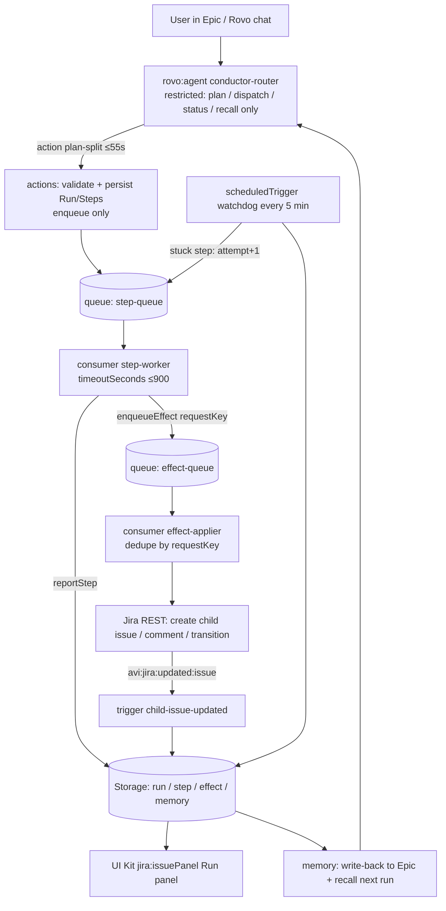

# Ticket Conductor — Design Spec (v1, 2026-11-01)

> **中文摘要**：Ticket Conductor 是 Codegeist 2026 参赛作品（主赛道 Apps for Software Teams，Bonus 报 Best Agents）。采用 Router/Ticket/Worker 三层架构，运行在 Jira/Forge 之上：受限的 Router（rovo:agent）只负责受理和入队；每个子任务是一张 Jira 子工单，并在 Forge 存储里有 run/step/effect/memory 记录；Worker 是异步队列消费者（最长 900 秒）；所有 Jira 副作用经过按 `request_key` 去重的 effects 队列；Watchdog 定时任务重试卡住的 step；跑完把总结和决策写回 Epic，下次召回。第一周先做 WP0 能力实测（Forge 函数能否调 LLM、Rovo agent 能否互相派活、rovo:skill 语法、Forge SQL 配额），每项都有降级方案。截止：2026-12-22 12:00 PT（北京时间 12-23 04:00）。

## 1. Goals and non-goals

Goals (MVP, demoable end-to-end in ≤3 minutes):
1. A user on an Epic asks Rovo: "Conductor, plan and run this".
2. Router proposes a plan (3–8 steps); on confirm it is persisted and child issues are created.
3. Workers execute steps in parallel (async events), report results; the issue panel shows a live tree + timeline.
4. A deliberately stuck step is retried by the Watchdog; a duplicate request is deduplicated by `requestKey`.
5. On completion a summary + decisions comment is written to the Epic; a later run on a related Epic recalls those decisions.

Non-goals: Marketplace publishing, Teamwork Graph writes, production deploys by agents, external paid LLMs unless WP0 forces it.

## 2. Architecture

### 2.1 Router (restricted supervisor)
- `rovo:agent` `conductor-router`. Its prompt (WP7) allows only these actions: `plan-split`, `dispatch-run`, `get-run-status`, `recall-memory`, `record-decision`. It never writes Jira directly.
- Actions run ≤55 s: they validate input, write storage, enqueue, and return. No long work inside an action.
- Planning: in the default design the **Router's own Rovo model** produces the plan as structured JSON and passes it to `plan-split` (no external LLM). See open question Q1.

### 2.2 Ticket (Jira child issue + storage records)
Each plan step = one Jira child issue (Sub-task or child of the Epic) plus a `step` record. Jira is the human-visible ledger; storage is the machine state.

### 2.3 Workers
- `consumer` `step-worker` on queue `step-queue`, `timeoutSeconds: 900`.
- One event per step: `{runId, stepId, attempt}`. Worker loads step, runs its `workerType` handler (`research`, `draft-spec`, `check-deps`, `summarize`, …), writes `output`, emits effects (comment on child issue, transition) and calls `reportStep`.
- Workers are idempotent per `(stepId, attempt)`; a stale attempt exits without side effects.

### 2.4 Effects queue (idempotent)
- Every Jira mutation is an `effect` with a deterministic `requestKey = sha256(runId|stepId|kind|attempt-independent-discriminator)`.
- `enqueueEffect` writes the effect if the key does not exist (else returns existing) then pushes `{requestKey}` to `effect-queue`.
- `effect-applier` re-reads, skips if `status=applied`, applies, stores result (`issueKey`, `commentId`), marks `applied`. Failures: `retrying` with backoff up to 5, then `failed` → step `blocked`.

### 2.5 Watchdog
- `scheduledTrigger` interval `fiveMinute` → `watchdog` function.
- Finds steps `status=running AND deadlineAt < now` or `status=queued` older than 10 min; if `attempt < 3` sets `attempt+1`, new `deadlineAt`, re-enqueues; else marks `failed` and run `blocked`, and enqueues an Epic comment effect.
- Also re-pushes effects stuck in `pending/retrying`.

### 2.6 Run memory
- On run `done`: `summarize` worker produces summary + decisions → effect: Epic comment (marked with a `[Conductor memory]` header) + `memory` records (`scope=project`, `type=decision|lesson|fact`).
- On next `plan-split`/`recall-memory`: return top-k memories for the project (keyword/label match on goal + Epic summary; no vector DB), excluding `supersededBy` or expired.

## 3. Data model

Default store: **Forge Custom Entity Store** (works without Forge SQL; see Q4). Keys/indexes:

| Entity | Fields | Indexes |
|---|---|---|
| `run` | runId (uuid), epicKey, projectKey, goal, status `planning\|running\|blocked\|done\|failed`, createdBy, createdAt, updatedAt, summary | `by-epic` (epicKey, createdAt) , `by-status` |
| `step` | stepId, runId, idx, title, workerType, childIssueKey, status `queued\|running\|done\|failed\|blocked`, attempt, deadlineAt, output (≤ 64 KiB, larger → Jira comment ref), error | `by-run` (runId, idx), `by-status-deadline` (status, deadlineAt) |
| `effect` | requestKey (primary), runId, stepId, kind `createIssue\|comment\|transition`, payload, status `pending\|applied\|retrying\|failed`, tries, result, appliedAt | `by-status` (status, updatedAt), `by-run` |
| `memory` | memId, projectKey, scope `project\|epic`, type `decision\|lesson\|fact`, text, sourceIssue, runId, validUntil, supersededBy, createdAt | `by-project` (projectKey, createdAt) |

KVS keys (small counters/locks): `lock:run:<runId>` (optimistic lock), `idem:dispatch:<epicKey>:<hash(goal)>`.

## 4. Manifest modules (target)

| Module | Key | Notes |
|---|---|---|
| `rovo:agent` | `conductor-router` | prompt from `prompts/router.md`; actions listed above |
| `action` | `plan-split`, `dispatch-run`, `get-run-status`, `recall-memory`, `record-decision` | actionVerb GET/CREATE/UPDATE |
| `rovo:skill` | `conductor-playbook`, `conductor-tools` | Preview. `conductor-tools` is the procedure other agents follow. Tools are same-app action keys. |
| `consumer` | `step-worker` (queue `step-queue`), `effect-applier` (queue `effect-queue`) | function `timeoutSeconds: 900` |
| `scheduledTrigger` | `watchdog` | interval `fiveMinute` |
| `trigger` | `child-issue-updated` | `avi:jira:updated:issue`, `avi:jira:commented:issue` |
| `jira:issuePanel` | `run-panel` | UI Kit, resolver `panelResolver` |
| `function` | one per handler | |
| `entities` (storage) | run, step, effect, memory | `app.storage.entities` |
| permissions.scopes | `read:jira-work`, `write:jira-work`, `storage:app`, `read:jira-user` | optional `read:confluence-content.all` |
| `rovo:mcp` | `conductor-mcp` | Preview, one per app. Tools: plan-split, dispatch-run, get-run-status, recall-memory. External clients stay disabled until an admin enables them. |
| `rovo:agent` | `conductor-handoff` | Second agent. Calls the same four tools and reads status back. |
| optional | `jira:projectPage` | stretch |

The existing app id `ari:cloud:ecosystem::app/00000000-0000-4000-8000-0000000000a1` must not change.

## 5. Verified platform limits

| Item | Limit | Source |
|---|---|---|
| Regular function / UI resolver | 25 s | https://developer.atlassian.com/platform/forge/limits-invocation/ (updated 2026-09-01) |
| Web trigger / action / rovo:agentConnector | 55 s | same |
| Async event consumer & scheduled trigger | 55 s default, up to **900 s** via `timeoutSeconds` | same |
| Single outbound request in async event | 180 s | same |
| Invocation rate | 1,200/min per user; 7,000/min and 300/s per installation | same |
| KVS / Entity Store | value 240 KiB, key 500 chars, depth 31, 1,000 RPS per installation | https://developer.atlassian.com/platform/forge/limits-kvs-ce/ (2026-09-28) |
| Egress | must be declared in `permissions.external.fetch.backend` (affects "Runs on Atlassian") | https://developer.atlassian.com/platform/forge/runtime-egress-permissions/ |
| rovo:mcp | Preview, one per app | https://developer.atlassian.com/platform/forge/manifest-reference/modules/rovo-mcp/ (2026-10-29) |
| Storage options | KVS, Custom Entity Store, Forge SQL, Object Store (Preview) | https://developer.atlassian.com/platform/forge/platform-quotas-and-limits/ |

## 6. Open questions (WP0 spikes) and fallbacks

| # | Question | Fallback if "no" |
|---|---|---|
| Q1 | Can Forge functions call an Atlassian-hosted LLM (Forge LLM / Rovo) directly? (`/platform/forge/llm-api/` returned 404 when checked) | Router's Rovo model does all reasoning and passes structured JSON to actions; workers are deterministic (Jira/Confluence lookups, templated drafts). Last resort: external LLM with declared egress + secret in `forge variables set --encrypt`. |
| Q2 | Can one Rovo agent invoke / delegate to another (assignable agents, `rovo:agentConnector`)? | Workers are async functions inside this app (default design). Specialist "agents" are worker types, shown as such in the UI. |
| Q3 | `rovo:skill` manifest syntax and whether other agents can invoke it | Confirmed in [docs/spike-rovo-skill-mcp.md](spike-rovo-skill-mcp.md). Other agents invoke `action` keys (same app, or `rovo:mcp`). A skill is the procedure, not a cross-app call. Fallback if `rovo:mcp` is rejected at deploy: keep the actions and the handoff agent. |
| Q4 | Forge SQL quotas / availability on dev site | Use Custom Entity Store (default above); SQL only if indexes prove insufficient. |

## 7. Flight recorder

See [docs/flight-recorder.md](flight-recorder.md). Every run has an append-only `event` log and a step journal keyed by `requestKey` (DBOS / Temporal style). **Replay against today's Jira, with a diff of what would change and zero duplicate writes.** Fork copies the log up to step N and re-runs only the downstream steps. The shape is borrowed from LangGraph, Temporal, and DBOS; the runtimes are not. A Magentic-One stall counter logs `replan` after two stalls. Event `span` fields use the OpenTelemetry GenAI names (`gen_ai.operation.name`, `gen_ai.request.model`, and the rest) inside an `any` attribute, because Forge attribute names cannot contain dots. When a step ran on the Forge LLM, `gen_ai.request.model` is that model id. Replay forces the deterministic fallback so it does not call the model, and it diffs lessons using `validFrom`/`validTo` at the run's `createdAt`.

## 8. Milestones
W1 11/2–11/8 WP0 spikes + scaffolding · W2 store + actions + worker · W3 effects + state machine + trigger · W4 UI panel + watchdog · W5 memory · W6 polish + demo data + (optional MCP) · W7 video + Devpost copy · buffer 12/21–12/22.
